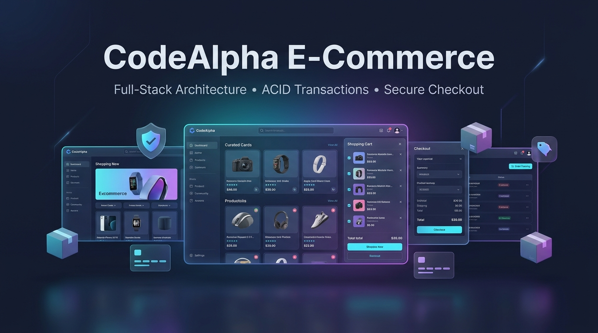
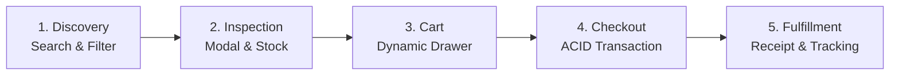

# CodeAlpha E-commerce Store 🛍️

<p align="center">
  
</p>

<p align="center">
  <strong>A production-grade, secure, and responsive full-stack e-commerce web application engineered for the CodeAlpha Full Stack Development Internship — Task 1.</strong>
</p>

<p align="center">
  <a href="https://nodejs.org/"></a>
  <a href="https://sqlite.org/"></a>
  <a href="LICENSE"></a>
  <a href="docs/SECURITY.md"></a>
</p>

---

## 📖 Table of Contents

- [Project Overview](#-project-overview)
- [Application Workflow & User Steps](#-application-workflow--user-steps)
- [Key Features](#-key-features)
- [Technology Stack](#-technology-stack)
- [System Architecture](#-system-architecture)
- [Prerequisites](#-prerequisites)
- [Step-by-Step Setup Guide](#-step-by-step-setup-guide)
- [Running Tests](#-running-tests)
- [Documentation Suite](#-documentation-suite)
- [Security Considerations](#-security-considerations)
- [Author & Internship Information](#-author--internship-information)

---

## 🌟 Project Overview

CodeAlpha E-commerce Store delivers an end-to-end shopping journey with an emphasis on clean architecture, sub-millisecond query performance, and rock-solid transaction safety. Built according to official internship specifications using **HTML5, modern CSS3, and Vanilla JavaScript (ES Modules)** on the frontend and **Node.js with Express.js** on the backend, the store guarantees **100% server-authoritative pricing** and **atomic inventory management** via transactional relational storage.

---

## 🔄 Application Workflow & User Steps

The application follows an intuitive, robust 5-step operational flow from product discovery through order fulfillment:



### 🛍️ Step-by-Step Customer Journey

1. **Step 1: Product Discovery & Smart Filtering**
   - Instant search with client-side debouncing across product titles and descriptions.
   - Dynamic category pills (`All`, `Electronics`, `Fashion`, `Home & Living`, `Accessories`).
   - Sorting options: Price (Low to High / High to Low), Customer Rating, and Newest arrivals.

2. **Step 2: Product Inspection & Stock Verification**
   - Click any card to launch the **Product Details Modal**.
   - Review high-resolution visual assets, detailed specifications, and live inventory badges (`In Stock`, `Low Stock`, `Out of Stock`).
   - Adjust quantities with client-side boundary checks that respect physical inventory limits.

3. **Step 3: Interactive Cart Management**
   - Smooth slide-out cart drawer with animated item entries and optimistic badge counter updates.
   - Dynamically adjust item quantities or remove line items with automatic recalculation of estimated subtotals.
   - Cart persistence via browser local storage synchronized across open tabs.

4. **Step 4: Server-Authoritative Checkout (ACID Guarantee)**
   - Fill in authenticated or guest shipping details (Full Name, Email, Address, City, Postal Code).
   - Zero-trust security: Client subtotal is discarded; backend queries SQLite for real-time prices.
   - Atomic SQLite transaction: Decrements stock levels and creates order records simultaneously. If any item is out of stock, the transaction immediately rolls back without partial states.

5. **Step 5: Order Confirmation & History Tracking**
   - Instant visual order confirmation receipt with a cryptographically unique Order Tracking ID.
   - Direct link to the **Orders Dashboard** (`/orders.html`) displaying past purchases, delivery status (`Pending`, `Processing`, `Shipped`, `Delivered`), and itemized receipts.

---

## ✨ Key Features

### 🛍️ Storefront & Product Discovery

- **Modern Responsive Design:** Crafted with custom design tokens, accessible contrast, smooth micro-interactions, and responsive layout across mobile, tablet, and desktop.
- **Dynamic Search & Filtering:** Debounced real-time product search with multi-category filtering (Electronics, Fashion, Home & Living, Accessories).
- **Multi-Factor Sorting:** Sort by Price (Low to High, High to Low), Rating, or Newest Additions.
- **Product Details Modal:** High-resolution product images, comprehensive specifications, live inventory badges, and quantity selectors.

### 🛒 Shopping Cart & Checkout

- **Interactive Cart Drawer:** Slide-out drawer with optimistic UI updates and live item count badges.
- **Inventory Protection:** Prevents customers from selecting or buying more units than currently in stock.
- **Server-Side Price Calculation:** Zero trust of client-sent subtotals or prices. The backend retrieves the latest unit prices directly from the database and recalculates subtotals, taxes, and shipping.
- **Atomic Checkout (ACID):** Creates orders, inserts line items, and decrements stock inside a single, rollback-safe database transaction.
- **Instant Order Confirmation:** Clear visual receipts, unique Order IDs, and status tracking (`Pending`, `Processing`, `Shipped`, `Delivered`).

### 🔐 Authentication & Account Management

- **Secure Registration & Login:** Password hashing with `bcryptjs` (12 rounds) and robust Zod schema validation.
- **HttpOnly JWT Sessions:** Immunity against client-side script token theft via secure, `SameSite=Lax` cookies.
- **Order History Dashboard:** Authenticated users can inspect their past purchases, delivery addresses, and itemized receipts.

---

## 🛠️ Technology Stack

| Layer | Technologies Used |
| :--- | :--- |
| **Frontend** | Semantic HTML5, Modern CSS3 (Custom Properties & Design Tokens), Vanilla JavaScript (ES6+ Modules) |
| **Backend** | Node.js, Express.js (Layered MVC: Routes, Controllers, Services, Models, Middleware) |
| **Database** | SQLite 3 via `better-sqlite3` (WAL mode enabled, Foreign Key constraints enforced) |
| **Authentication** | JSON Web Tokens (`jsonwebtoken`), `bcryptjs`, `cookie-parser` |
| **Validation & Security** | `zod`, `helmet`, `cors`, `express-rate-limit` |
| **Testing** | Node.js Test Runner / Jest / Supertest |

---

## 🏛️ System Architecture

```text
CodeAlpha_EcommerceStore/
├── public/                 # Frontend Static Assets & Web Pages
│   ├── index.html          # Main Storefront & Product Grid
│   ├── product.html        # Detailed Product View
│   ├── cart.html           # Dedicated Shopping Cart View
│   ├── checkout.html       # Secure Checkout Form
│   ├── orders.html         # Customer Order History
│   ├── login.html          # User Login
│   ├── register.html       # User Registration
│   ├── css/                # Token-based CSS Architecture
│   │   ├── tokens.css      # Design Tokens (Colors, Typography, Spacing)
│   │   ├── base.css        # Reset, Layout, & Global Styles
│   │   └── components.css  # Buttons, Cards, Modals, Drawers, Badges
│   └── js/                 # Modular ES6+ Client Scripts
│       ├── api.js          # Unified Fetch Wrapper & Interceptors
│       ├── auth.js         # Authentication State & UI Sync
│       ├── cart.js         # Cart State, Storage, & Event Dispatcher
│       ├── store.js        # Catalog Rendering, Filtering, & Search
│       └── ui.js           # Toast Notifications & Dialog Handlers
├── src/                    # Backend Source Code
│   ├── server.js           # HTTP Server Initialization
│   ├── app.js              # Express Application & Middleware Mounts
│   ├── config/             # Environment & App Configuration
│   ├── database/           # SQLite Connection, Schema, & Seeds
│   ├── middleware/         # Auth Guard, Rate Limiter, Error Handler
│   ├── routes/             # RESTful Versioned API Routes (/api/v1/*)
│   ├── controllers/        # Request Handlers
│   ├── services/           # Business Logic & Transactions
│   └── validations/        # Zod Request Schemas
├── docs/                   # Complete Engineering Documentation Suite
└── tests/                  # Automated Unit & Integration Tests
```

---

## ⚙️ Prerequisites

- **Node.js:** `v18.0.0` or higher (Tested on `v25.1.0`)
- **npm:** `v9.0.0` or higher
- **Git:** Installed on system

---

## 🚀 Step-by-Step Setup Guide

Follow these sequential steps to configure, seed, and launch the CodeAlpha E-Commerce Store locally:

### Step 1: Clone or Open the Repository

```bash
git clone https://github.com/YourUsername/CodeAlpha_EcommerceStore.git
cd CodeAlpha_EcommerceStore
```

### Step 2: Install Node Dependencies

Ensure all production and development dependencies are installed:

```bash
npm install
```

### Step 3: Configure Environment Variables

Copy the environment template file:

```bash
# On Linux/macOS
cp .env.example .env

# On Windows PowerShell
Copy-Item .env.example .env
```

*(Default settings use port `5000` and `src/database/ecommerce.db`)*

### Step 4: Initialize & Seed Database

Execute the database initialization script to build tables with WAL mode, foreign keys, and seed 12 realistic products across 4 categories:

```bash
npm run db:seed
```

### Step 5: Launch Development Server

Start the Express application with live reload enabled:

```bash
npm run dev
```

Open **[http://localhost:5000](http://localhost:5000)** in your web browser.

---

## 🧪 Running Tests

Execute the automated test suite verifying authentication, catalog queries, and transactional checkout:

```bash
# Run all tests
npm test

# Run integration tests
npm run test:api
```

---

## 📚 Documentation Suite

Comprehensive technical documentation is maintained under the `docs/` folder:

- **[Product Requirements Document (docs/PRD.md)](docs/PRD.md):** User personas, functional requirements, and acceptance criteria.
- **[Technical Requirements Document (docs/TRD.md)](docs/TRD.md):** Architectural patterns, data flow, and error strategies.
- **[REST API Documentation (docs/API.md)](docs/API.md):** All endpoints, request/response schemas, and error codes.
- **[Database Architecture (docs/DATABASE.md)](docs/DATABASE.md):** ERD, table definitions, constraints, indexes, and transactions.
- **[Security Architecture (docs/SECURITY.md)](docs/SECURITY.md):** Threat modeling, OWASP protections, and hashing policies.
- **[Testing Strategy (docs/TESTING.md)](docs/TESTING.md):** Test pyramid, test cases, and regression procedures.
- **[Implementation Plan (docs/IMPLEMENTATION_PLAN.md)](docs/IMPLEMENTATION_PLAN.md):** Development milestones and progress tracking.
- **[Architecture Decision Records (docs/DECISIONS.md)](docs/DECISIONS.md):** Architectural decisions and technical trade-offs.

---

## 🔒 Security Considerations

- **Password Protection:** Uses `bcryptjs` with salt round factor 12.
- **XSS Mitigation:** Session tokens stored in `HttpOnly` cookies inaccessible to JavaScript.
- **SQLi Prevention:** 100% parameterized queries via prepared statements.
- **DoS Defense:** `express-rate-limit` limits sensitive auth and API requests.
- **HTTP Hardening:** `helmet` sets secure CSP, HSTS, frameguard, and referrer policies.

---

## 👨‍💻 Author & Internship Information

- **Internship:** CodeAlpha Full Stack Development Internship
- **Task:** Task 1 — Simple E-commerce Store
- **Organization:** [CodeAlpha](https://www.codealpha.tech/)
