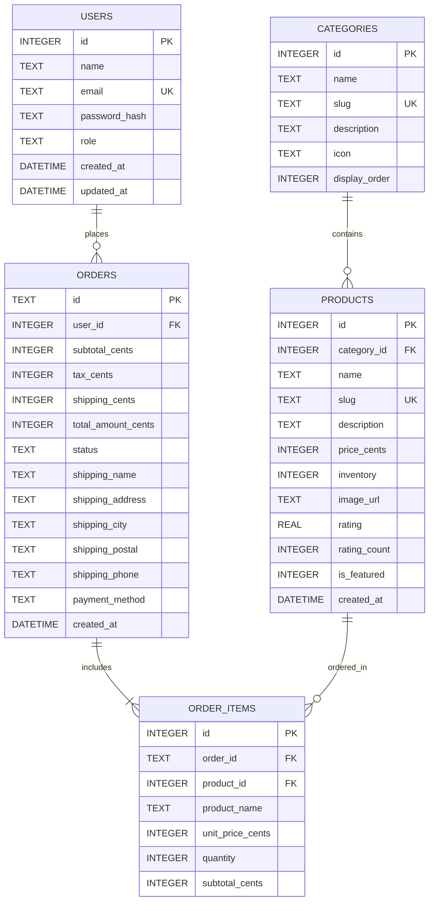

# Database Documentation

## Database Engine: SQLite 3 (WAL Mode)
**Driver:** `better-sqlite3` (C++ bindings, synchronous execution, zero async race conditions, native ACID transactions)  
**File Location:** `src/database/ecommerce.db`

---

## 1. Entity Relationship Diagram (ERD)



---

## 2. Table Definitions & Schemas

### `users`
| Column | Type | Constraints | Description |
| :--- | :--- | :--- | :--- |
| `id` | `INTEGER` | `PRIMARY KEY AUTOINCREMENT` | Unique identifier for user |
| `name` | `TEXT` | `NOT NULL` | Full customer or admin name |
| `email` | `TEXT` | `NOT NULL UNIQUE COLLATE NOCASE` | Normalized email address |
| `password_hash` | `TEXT` | `NOT NULL` | bcrypt hash with salt (cost 12) |
| `role` | `TEXT` | `NOT NULL DEFAULT 'customer'` | Options: `'customer'`, `'admin'` |
| `created_at` | `DATETIME` | `DEFAULT CURRENT_TIMESTAMP` | Registration timestamp |
| `updated_at` | `DATETIME` | `DEFAULT CURRENT_TIMESTAMP` | Last profile update |

### `categories`
| Column | Type | Constraints | Description |
| :--- | :--- | :--- | :--- |
| `id` | `INTEGER` | `PRIMARY KEY AUTOINCREMENT` | Category ID |
| `name` | `TEXT` | `NOT NULL UNIQUE` | Human-readable name |
| `slug` | `TEXT` | `NOT NULL UNIQUE` | URL-friendly identifier |
| `description` | `TEXT` | `NULL` | Category overview |
| `icon` | `TEXT` | `NULL` | UI SVG icon identifier |
| `display_order` | `INTEGER` | `DEFAULT 0` | Ordering priority |

### `products`
| Column | Type | Constraints | Description |
| :--- | :--- | :--- | :--- |
| `id` | `INTEGER` | `PRIMARY KEY AUTOINCREMENT` | Product ID |
| `category_id` | `INTEGER` | `NOT NULL REFERENCES categories(id) ON DELETE RESTRICT` | Associated category |
| `name` | `TEXT` | `NOT NULL` | Product title |
| `slug` | `TEXT` | `NOT NULL UNIQUE` | URL slug |
| `description` | `TEXT` | `NOT NULL` | Detailed marketing & technical description |
| `price_cents` | `INTEGER` | `NOT NULL CHECK(price_cents >= 0)` | Price in cents (prevents float math errors) |
| `inventory` | `INTEGER` | `NOT NULL CHECK(inventory >= 0)` | Available stock count |
| `image_url` | `TEXT` | `NOT NULL` | Static asset path or hosted image URL |
| `rating` | `REAL` | `DEFAULT 5.0 CHECK(rating >= 0 AND rating <= 5)` | Average star score |
| `rating_count` | `INTEGER` | `DEFAULT 0` | Total review count |
| `is_featured` | `INTEGER` | `DEFAULT 0 CHECK(is_featured IN (0,1))` | Highlight on homepage |
| `created_at` | `DATETIME` | `DEFAULT CURRENT_TIMESTAMP` | Addition date |

### `orders`
| Column | Type | Constraints | Description |
| :--- | :--- | :--- | :--- |
| `id` | `TEXT` | `PRIMARY KEY` | Formatted human ID (e.g. `ORD-20261017-001`) |
| `user_id` | `INTEGER` | `NOT NULL REFERENCES users(id) ON DELETE RESTRICT` | Placing customer |
| `subtotal_cents` | `INTEGER` | `NOT NULL` | Calculated sum of line items |
| `tax_cents` | `INTEGER` | `NOT NULL` | Server-calculated tax |
| `shipping_cents` | `INTEGER` | `NOT NULL` | Calculated shipping fee |
| `total_amount_cents` | `INTEGER` | `NOT NULL` | Final charge |
| `status` | `TEXT` | `NOT NULL CHECK(status IN ('pending', 'processing', 'shipped', 'delivered', 'cancelled'))` | Lifecycle stage |
| `shipping_name` | `TEXT` | `NOT NULL` | Recipient name |
| `shipping_address`| `TEXT` | `NOT NULL` | Street address |
| `shipping_city` | `TEXT` | `NOT NULL` | City |
| `shipping_postal` | `TEXT` | `NOT NULL` | Postal/ZIP code |
| `shipping_phone` | `TEXT` | `NOT NULL` | Contact number |
| `payment_method` | `TEXT` | `NOT NULL DEFAULT 'cod'` | `cod`, `mock_card` |
| `created_at` | `DATETIME` | `DEFAULT CURRENT_TIMESTAMP` | Order timestamp |

### `order_items`
| Column | Type | Constraints | Description |
| :--- | :--- | :--- | :--- |
| `id` | `INTEGER` | `PRIMARY KEY AUTOINCREMENT` | Item record ID |
| `order_id` | `TEXT` | `NOT NULL REFERENCES orders(id) ON DELETE CASCADE` | Parent order |
| `product_id` | `INTEGER` | `NOT NULL REFERENCES products(id) ON DELETE RESTRICT` | Referenced product |
| `product_name` | `TEXT` | `NOT NULL` | Snapshot of product title at time of order |
| `unit_price_cents`| `INTEGER` | `NOT NULL` | Snapshot of unit price at time of order |
| `quantity` | `INTEGER` | `NOT NULL CHECK(quantity > 0)` | Number of units ordered |
| `subtotal_cents` | `INTEGER` | `NOT NULL` | `unit_price_cents * quantity` |

---

## 3. Database Indexes
To maintain sub-millisecond query performance:
```sql
CREATE INDEX idx_products_category ON products(category_id);
CREATE INDEX idx_products_featured ON products(is_featured);
CREATE INDEX idx_products_price ON products(price_cents);
CREATE INDEX idx_orders_user ON orders(user_id);
CREATE INDEX idx_orders_status ON orders(status);
CREATE INDEX idx_order_items_order ON order_items(order_id);
CREATE INDEX idx_users_email ON users(email);
```

---

## 4. Transaction Requirements (Checkout & Inventory)
Order placement requires an atomic database transaction. If inventory is insufficient for even one line item, the entire transaction rolls back immediately:

```javascript
const createOrderTx = db.transaction((orderData, items) => {
  // 1. Verify and lock inventory for all items
  for (const item of items) {
    const product = db.prepare('SELECT id, name, price_cents, inventory FROM products WHERE id = ?').get(item.product_id);
    if (!product || product.inventory < item.quantity) {
      throw new AppError(`Insufficient inventory for ${product ? product.name : 'item'}`, 409);
    }
  }

  // 2. Insert order record
  db.prepare(`INSERT INTO orders (...) VALUES (...)`).run(...);

  // 3. Insert order items & decrement inventory
  for (const item of items) {
    db.prepare(`INSERT INTO order_items (...) VALUES (...)`).run(...);
    db.prepare(`UPDATE products SET inventory = inventory - ? WHERE id = ?`).run(item.quantity, item.product_id);
  }

  return orderData.id;
});
```
